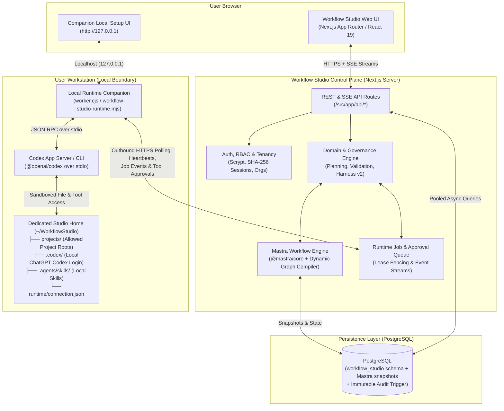
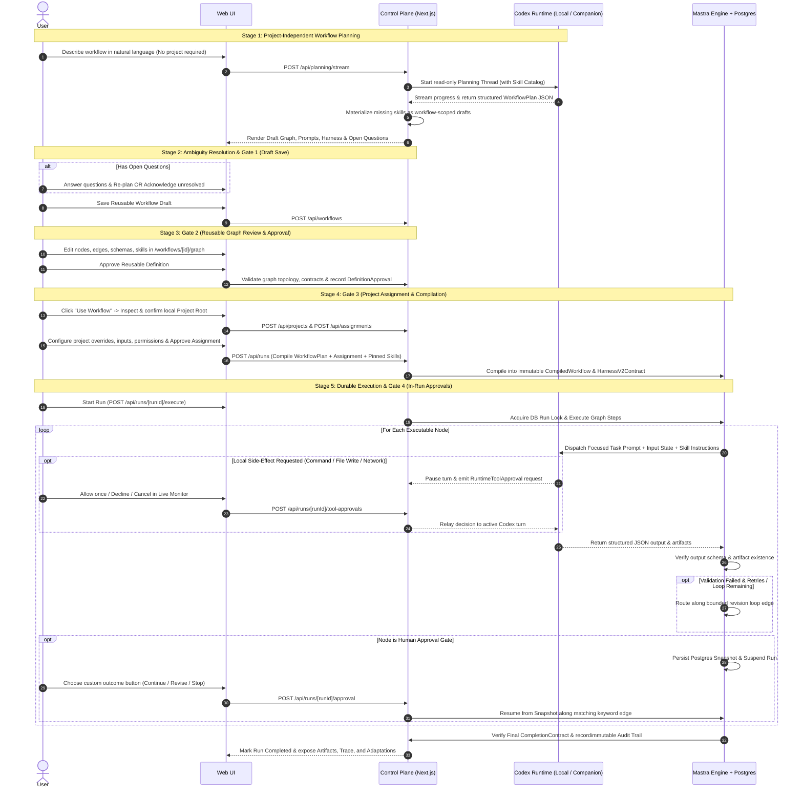

# Workflow Studio — Complete Project & Architecture Guide

> **Core Product Statement:** *Codex executes the work. Workflow Studio governs which approved process runs against which project, under which controls, and with which evidence.*

Runtime update, 2026-10-26: PostgreSQL revisions and transactional receipts are authoritative; Mastra schedules/checkpoints them, and companion 0.2.0 durably saves results before delivery. Explicit fork/join execution supports concurrent read-only branches with exclusive project writers. See [runtime ownership, parallel semantics and rollout](./docs/runtime-reliability-and-parallel.md) and [implementation evidence](./plan/phases/phase9-implementation-report.md).

---

## 1. Executive Summary & Product Purpose

**Workflow Studio** is a domain-neutral visual governance, orchestration, and execution control plane for **Codex-powered agent workflows**. Rather than acting as another conversational AI assistant or replacing OpenAI Codex, Workflow Studio wraps Codex in an operational lifecycle designed for engineering and product teams that need agent work to be **repeatable, reviewable, policy-constrained, and auditable across real local projects**.

### How It Differs from Other Agent Tools

| Tool / Experience | Primary Role | Where Workflow Studio Fits |
| :--- | :--- | :--- |
| **Direct Codex** | Adaptive, one-off execution in a repository where the agent chooses its own path. | Best for single tasks. Workflow Studio is used when a process must be standardized and repeated across projects/teams. |
| **ChatGPT Workspace Agents** | Shared specialist personas created via natural language. | Provides specialist chat; Workflow Studio enforces multi-stage graphs, project boundaries, schemas, and human gates. |
| **Visual Agent Builders** | Assemble multi-step agent graphs for app deployment/SDKs. | Workflow Studio focuses on **internal operational governance**: reusable definition approval, project assignment isolation, local companion execution, and immutable audit evidence. |

### The Four Engineering Pillars

Workflow Studio makes four foundational AI engineering disciplines explicit, inspectable, and enforceable in the UI and runtime:

1. **Prompt & Context Engineering:** Decomposes a user's high-level goal into focused per-node prompts, explicit input/output keys, pinned skill instructions, and token budgets rather than passing a monolithic prompt to every step.
2. **Graph Engineering:** Represents workflows as directed graphs with typed nodes (`codex`, `agent`, `tool`, `validation`, `approval`, `loop`, `fork`, `join`, `success`, `failure`), conditional branches, concurrency budgets, and explicit routing keywords.
3. **Loop Engineering:** Models revision cycles (`draft -> review -> revise -> validate -> approve`) as bounded loops with explicit entry/exit conditions and maximum iteration ceilings.
4. **Harness Engineering (Harness v2):** Enforces a 6-layer governance contract around every run covering identity, runtime sandboxing, observability, verification contracts, human-approved adaptation, and security/audit.

---

## 2. Technology Stack

| Layer | Technology | Version / Details |
| :--- | :--- | :--- |
| **Runtime Environment** | Node.js | `>=24.15.0 <25` (pinned to `24.15.0`) |
| **Web Control Plane & UI** | Next.js (App Router) + React | Next.js `16.3.3`, React `19.2.8`, TypeScript `5.5.4` |
| **Workflow Orchestration Engine** | Mastra | `@mastra/core` `1.65.0`, `@mastra/pg` `1.23.0` |
| **Agent Planning & Execution** | OpenAI Codex | `@openai/codex` `0.149.1` (Codex App Server over `stdio` + CLI fallback) |
| **Control Plane Database** | PostgreSQL | `pg` `^8.23.0` (Local PostgreSQL or Aiven managed PostgreSQL with TLS) |
| **Schema & Contract Validation** | Zod + Custom Validators | `zod` `4.5.4` + JSON Schema contracts |
| **Local Runtime Companion** | Standalone Next.js App | Located in `/companion`, packaged with portable Node.js `24.15.0` |
| **Testing & Quality** | Vitest, PGlite, ESLint | `vitest` `4.1.11`, `@electric-sql/pglite` (in-memory Postgres testing) |

---

## 3. High-Level System Architecture

Workflow Studio separates the **Control Plane** (which can run locally or be deployed to a cloud server/container) from the **User-Owned Local Runtime** (which runs on the user's workstation where their files and Codex login live).



### Two Execution Modes

1. **Direct Local Mode (`CODEX_RUNTIME_MODE=local`, default for `npm run dev`):**
   - The Next.js server spawns `Codex App Server` directly on the same machine over `stdio` (falling back to non-interactive Codex CLI only on provider failure).
2. **Paired Companion Mode (`CODEX_RUNTIME_MODE=paired`, production default):**
   - The web control plane never touches a host's Codex CLI or filesystem directly, and **never collects an OpenAI API key**.
   - Each user pairs their own computer using a 10-minute, single-use high-entropy pairing code.
   - The **Companion** polls the control plane over outbound HTTPS, leases jobs scoped strictly to that user, runs `Codex App Server` locally using the user's personal ChatGPT Codex login, enforces canonical path boundaries (`<WORKFLOW_STUDIO_HOME>/projects`), and streams events and local action approval requests back to the UI.

---

## 4. End-to-End Lifecycle & Data Flow

Workflow Studio enforces **four independent lifecycle gates** so that AI generation never bypasses human governance:



---

## 5. Deep Dive: Core Subsystems

### 5.1 Prompt & Context Engineering (`/src/domain/planning*.ts`, `/src/adapters/focused-task.ts`)
- **Two-Mode Codex Separation:**
  1. **Planning Mode:** Sends the user's natural-language request, constraints, and available skill catalog to Codex using `planning-response.schema.json`. Produces a `WorkflowPlan` containing nodes, edges, open questions, and completion criteria.
  2. **Execution Mode:** Compiles a **focused node prompt** (`focused-task-response.schema.json`) containing only that node's instructions, declared `inputKeys` from prior node outputs, pinned skill snapshots, approved adaptations, and active harness constraints.
- **Open Question Governance:** If Codex identifies ambiguities, they are surfaced in `openQuestions`. Users can answer them and trigger an iterative re-planning pass, keep the current graph with answers recorded, or explicitly confirm saving with unresolved questions.

### 5.2 Skill Registry & Composer (`/src/domain/generated-skills.ts`, `/src/domain/skill-matching.ts`, `scripts/repair-generated-skill-criteria.cjs`)
- **Skill Scoping:** Skills can be scoped as `global`, `project`, or `workflow`.
- **Stage-Scoped Automatic Draft Materialization:** When a generated workflow is saved, any new skill proposed by Codex—or any executable node lacking a skill—automatically generates a deterministic, workflow-scoped draft skill derived from that specific node's prompt, inputs, outputs, and required artifacts (explicitly preventing premature enforcement of downstream deliverables or later approvals). Includes `scripts/repair-generated-skill-criteria.cjs` to migrate older workflows that inherited global workflow completion criteria.
- **Catalog Matching:** Planning requests inspect local Codex skills (`<WORKFLOW_STUDIO_HOME>/.codex/skills` and `.agents/skills`) and published workspace skills, automatically matching capabilities (e.g., `imagegen`) and estimating token context sizes.
- **Version Pinning:** Workflows and runs pin exact `{ skillId, version }` references and snapshot skill instructions at compile time so edits to a skill never silently mutate existing runs.

### 5.3 Graph Engineering & Validation (`/src/domain/models.ts`, `/src/components/phase3-graph-editor.tsx`)
- **Node Types:**
  - `codex` / `agent`: Focused AI execution stages.
  - `tool`: Deterministic or tool-backed operations.
  - `validation`: Automated acceptance checks over state and artifacts.
  - `approval`: Human decision gates with customizable outcome buttons (`WorkflowApprovalOption` with `label`, `keyword`, and `action: 'continue' | 'revise' | 'stop'`).
  - `loop`: Explicit revision cycle controllers.
  - `success` / `failure`: Terminal graph states.
- **Pre-Approval Graph Validator (`validateWorkflowGraph`):**
  - Verifies reachability from entry nodes and paths to terminal states.
  - Detects missing upstream `inputKeys` (unless satisfied as external run inputs).
  - Detects unbounded cycles and ensures every back-edge loop is governed by a `maxLoopIterations` bound.
  - Validates that custom approval gate keywords (`continue` / `revise`) match outgoing edge conditions (`edge.condition`).

### 5.4 Reusable Definitions vs. Project Assignments (`/src/domain/workspace.ts`)
- **Reusable Workflow (`Workflow` / `WorkflowPlan`):** Created and approved on the dashboard without needing a project folder. Can be shared across an organization.
- **Project Workspace (`Project`):** Represents a confirmed local folder inside `<WORKFLOW_STUDIO_HOME>/projects`, inspected in read-only mode (`empty`, `repository`, or `workspace`).
- **Project Assignment (`ProjectWorkflow`):** Binds an approved reusable workflow to a specific `Project`. Holds project-specific input overrides, sandbox/tool permissions, skill version overrides, and optional graph overrides without mutating the source workflow definition.

### 5.5 Harness v2 Architecture (`/src/domain/runtime.ts`)
Every compiled run embeds a versioned `HarnessV2Contract` with 6 distinct layers:
1. **Identity & Behavior:** Purpose, agent role, pinned skill versions + SHA-256 integrity hashes, context manifest, and token budget (`contextBudgetTokens`).
2. **Runtime:** Engine (`Mastra`), executor (`Codex App Server`), `sandboxMode` (`read-only`, `workspace`, `isolated`), `allowedTools`, `allowedWorkspacePaths`, `maxRetries`, `maxLoopIterations`, `nodeTimeoutMs`, and `checkpoint-and-provider-interrupt` cancellation mode.
3. **Observability:** Correlation IDs (`runId`, `workflowId`, `assignmentId`, `projectId`), captured/unavailable metrics, and redaction policy version.
4. **Verification:** `completionCriteria`, `requiredOutputKeys`, `requiredArtifacts`, `humanGateNodeIds`, and the invariant `agentOutputAloneCanComplete: false`.
5. **Adaptation:** Controls whether evaluated lessons from a run can be proposed as `AdaptationCandidate` records (`run`, `project`, or `user` scope), enforcing `promotionRequiresHumanApproval: true` and `prohibitedSelfModification: true`.
6. **Governance & Security:** Owner user ID, least-privilege enforcement, destructive action approval flags, `append-only` audit journal policy, and retention days.

### 5.6 Mastra Orchestration, Runtime Engine & Resilient Recovery (`/src/adapters/mastra-adapter.ts`, `/src/domain/runtime-engine.ts`, `/src/domain/run-execution-settings.ts`)
- **Dynamic Compilation:** `MastraAdapter` compiles validated `WorkflowPlan` + `ProjectWorkflow` records into `@mastra/core` workflows (`createWorkflow`, `createStep`) with deterministic registration keys and SHA-256 fingerprints.
- **PostgreSQL Checkpointing:** Uses `@mastra/pg` (`PostgresStore`) alongside Workflow Studio's `runs` table to persist step transitions, suspend execution at human approval gates or missing external inputs (`pendingInput`), and resume cleanly when a decision or runtime input (`POST /api/runs/[runId]/inputs`) arrives.
- **Governed Run Execution Settings & Model Hierarchy (`/src/domain/model-settings.ts`, `/src/domain/run-execution-settings.ts`):**
  - Resolves execution model (`gpt-6-astra`, `gpt-5.6-sol`, `gpt-5.6-terra`, `gpt-5.6-luna`, `gpt-5.5`), reasoning effort (`low` to `ultra`), and output verbosity (`low`, `medium`, `high`) across a 5-tier hierarchy: `run` override -> `node` -> `workflow` -> `organization` -> `system`.
  - Users can edit execution settings (`POST /api/runs/[runId]/settings`) before a run starts or while paused at an undecided human approval gate. Changes require explicit confirmation if enabling workspace writes or disabling destructive-action approvals, and are recorded as numbered revisions (`executionConfiguration.revision`) in the run journal.
  - Pre-dispatch capability checks (`checkWorkflowCapabilities` in `/src/domain/capability-check.ts`) verify that the paired companion is online, supports the target model/reasoning effort, and meets the minimum companion version (`>= 0.1.1` for output verbosity).
- **Distributed Locks, Lease Fencing & Resilient Companion Recovery:**
  - `run_execution_locks` prevents concurrent execution of the same run across multiple server instances.
  - `runtime_jobs` uses monotonic `lease_id` tokens and `execution_key` idempotency constraints.
  - **Offline Wait & Supervised Worker Recovery (`companion/worker-supervisor.cjs`):** The companion sends independent 15-second heartbeats and reconciles the queue every 20 seconds. If a companion goes offline mid-run, the step enters `node.runtime-waiting` without burning node retries, preserving the queued job's execution identity. Unexpected worker exits are logged with token redaction to a 1 MiB rotating `runtime.log` and automatically restarted with exponential backoff (1s–30s).
- **Two Separate Approval Layers:**
  - **Workflow Gate Approval (`/api/runs/[runId]/approval`):** Chooses the next graph transition (`continue`, `revise`, `stop`) at an `approval` node.
  - **Local Action Approval (`/api/runs/[runId]/tool-approvals`):** Authorizes a single command execution, file modification, network call, or MCP elicitation requested by Codex App Server inside an active node turn.

### 5.7 Multi-Tenant Governance, Organizations & RBAC (`/src/auth/auth.ts`, `/src/domain/authorization.ts`)
- **Product Roles:** `builder`, `reviewer`, `administrator`. When `WORKFLOW_STUDIO_ENFORCE_ROLE_GATES=true`, only `reviewer` and `administrator` roles can approve workflow definitions, approve project assignments, decide in-run approval gates, or promote adaptations.
- **Delegated Reviewers:** Administrators can assign reviewers to specific builders (`reviewer_assignments`), giving them scoped access to review queues and artifacts.
- **Organizations:** Users can create organizations (`owner`, `administrator`, `reviewer`, `member`), invite members, set organization-wide default execution models/reasoning efforts, and publish approved workflows to shared organization libraries without exposing personal projects, companions, or private runs.

---

## 6. Repository Directory Structure

```text
WorkflowStudio/
├── companion/                        # Standalone local runtime companion Next.js app
│   ├── app/                          # Companion local UI (127.0.0.1) & API routes (/api/[action], /api/events)
│   ├── control.cjs                   # Local companion state & control helpers
│   ├── launcher.cjs                  # Companion process launcher & session cookie setup
│   ├── policy.cjs                    # URL, origin, and pairing code validation policy
│   ├── runtime-loader.cjs            # Bridges companion to scripts/workflow-studio-runtime.mjs
│   ├── service.cjs                   # Companion state machine (folder selection, Codex sign-in, worker supervision)
│   ├── start.cjs / start.bat         # Zero-install portable Node bootstrap & builder
│   ├── worker-supervisor.cjs         # Auto-restart supervisor with log rotation (runtime.log)
│   └── worker.cjs                    # Child worker process executing the paired runtime loop
├── certs/
│   └── aiven-ca.pem                  # CA certificate for managed Aiven PostgreSQL TLS verification
├── design-system/
│   └── README.md                     # "Structured Systems" design tokens, colors, typography & component specs
├── docs/                             # Operational, deployment, security, and companion documentation
│   ├── companion-distribution.md     # Packaging, Ed25519 signing, and user setup for the companion ZIP
│   ├── company-launch.md             # Production rollout, RBAC, and launch qualification runbook
│   ├── database-setup.md             # Local & Aiven PostgreSQL configuration, backup, and restore
│   ├── deployment.md                 # Container/VM deployment and user-owned runtime architecture
│   ├── local-runtime-companion.md    # Deep dive into companion pairing, recovery, and folder isolation
│   ├── operations-runbook.md         # Health checks, Prometheus metrics, retention, and incident response
│   └── security-threat-model.md      # Assets, trust boundaries, threats, controls, and verification evidence
├── plan/                             # Staged engineering specifications (Phases 1 through 8)
│   ├── design.md                     # UI/UX design direction ("Structured Systems")
│   ├── phase-01..08-*.md             # Architectural specs for each phase
│   └── phases/phase1..8-tasks.md     # Granular task tracking across all 8 phases
├── scripts/                          # Operational, database, qualification, and runtime CLI scripts
│   ├── workflow-studio-runtime.mjs   # Core local runtime agent & JSON-RPC stdio client for Codex App Server
│   ├── studio-home.cjs               # Enforces isolated <WORKFLOW_STUDIO_HOME> directory structure
│   ├── postgres-schema.sql           # Authoritative PostgreSQL schema & 14 versioned migrations
│   ├── check-database.cjs            # Verifies PostgreSQL connectivity
│   ├── verify-postgres.cjs           # Verifies tables, indexes, migrations, and immutable audit triggers
│   ├── postgres-backup.cjs           # Runs pg_dump custom-format backups
│   ├── postgres-restore.cjs          # Restores backups with explicit confirmation guards
│   ├── compare-postgres.cjs          # Compares source and restored DBs via row counts & SHA-256 fingerprints
│   ├── enforce-retention.cjs         # Prunes expired runs, audit logs, and sessions per policy
│   ├── package-companion.cjs         # Packages the portable Windows x64 companion ZIP + Ed25519 signature
│   ├── verify-companion-package.cjs  # Verifies companion ZIP checksum and detached Ed25519 signature
│   ├── load-smoke.mjs                # Concurrent load and latency smoke testing
│   ├── qualify-multi-instance.mjs    # Verifies multi-instance coordination, locks, and lease fencing
│   └── qualify-rollout.mjs           # End-to-end production promotion gate verifier
├── src/                              # Main Workflow Studio application source
│   ├── adapters/                     # External runtime & orchestration adapters
│   │   ├── codex-adapter.ts          # Abstract Codex planning & execution interfaces
│   │   ├── codex-app-server-adapter.ts # Rich stdio JSON-RPC integration with Codex App Server
│   │   ├── codex-cli-adapter.ts      # Non-interactive Codex CLI fallback for local provider failures
│   │   ├── codex-node-executor.ts    # Executes individual workflow nodes against Codex
│   │   ├── codex-runtime.ts          # Factory selecting Local vs. Paired runtime adapters
│   │   ├── focused-task.ts           # Prompt & schema compiler for focused node execution
│   │   ├── mastra-adapter.ts         # Real @mastra/core workflow compiler, runner, and Postgres snapshot manager
│   │   ├── paired-runtime-adapter.ts # Enqueues jobs to PostgreSQL and streams events from paired companions
│   │   ├── focused-task-response.schema.json
│   │   └── planning-response.schema.json
│   ├── app/                          # Next.js App Router pages & API endpoints
│   │   ├── page.tsx                  # Public product landing page
│   │   ├── login/ & signup/          # Authentication pages
│   │   ├── studio/page.tsx           # Unified Workflow Studio Dashboard
│   │   ├── workflows/                # /workflows/new and /workflows/[workflowId]/graph
│   │   ├── skills/                   # /skills, /skills/new, /skills/[skillId]/edit
│   │   ├── runs/                     # /runs (History) and /runs/[runId] (Live Execution Monitor)
│   │   └── api/                      # 48 backend route handlers (Auth, Planning, Workflows, Runs, Runtime, Orgs, Admin)
│   ├── auth/
│   │   └── auth.ts                   # Scrypt password hashing, HTTP-only session cookies, CSRF/Origin checks
│   ├── components/                   # 34 React UI components (Dashboard, Graph Editor, Live Monitor, Modals)
│   ├── domain/                       # Pure TypeScript domain models, validators, and business rules
│   │   ├── models.ts                 # WorkflowPlan, WorkflowNode, WorkflowEdge, HarnessPolicy, Graph validation
│   │   ├── workspace.ts              # Project, Workflow, Skill, ProjectWorkflow (Assignment) models
│   │   ├── runtime.ts                # WorkflowRun, CompiledWorkflow, HarnessV2Contract, Verification & Adaptation
│   │   ├── runtime-engine.ts         # State transitions, loop iteration tracking, retries, and gate resumption
│   │   ├── planning-orchestrator.ts  # Coordinates Codex planning, repair passes, and skill matching
│   │   ├── generated-skills.ts       # Materializes draft skills from generated workflow nodes
│   │   ├── skill-matching.ts         # Matches user prompts & nodes against installed Codex/workspace skills
│   │   ├── authorization.ts          # Role gates (builder, reviewer, administrator)
│   │   ├── model-settings.ts         # Model selection, reasoning effort, and verbosity validation
│   │   └── workspace-boundary.ts     # Path canonicalization, traversal prevention, and root boundary checks
│   ├── server/                       # Server-side utilities
│   │   ├── event-stream.ts           # Server-Sent Events (SSE) helpers
│   │   ├── rate-limit.ts             # PostgreSQL-backed distributed rate limiting
│   │   ├── redaction.ts              # Secret & token redaction for logs, exports, and support bundles
│   │   ├── runtime-auth.ts           # Companion bearer token verification
│   │   └── user-events.ts            # Real-time pub/sub event bus for UI updates
│   └── storage/                      # Asynchronous pooled PostgreSQL repositories
│       ├── postgres-store.ts         # Connection pooling, schema migration runner, and health checks
│       ├── async-database.ts         # Transactional query abstractions
│       ├── workflow-repository.ts    # CRUD & optimistic concurrency for WorkflowPlans
│       ├── run-repository.ts         # CRUD for WorkflowRuns
│       ├── run-execution-lock.ts     # Distributed database locks for active runs
│       ├── runtime-connection-repository.ts # Pairing codes, companion connections, job queue, leases, tool approvals
│       ├── workspace-stores.ts       # Tenant-scoped Projects, Workflows, Skills, and Assignments
│       ├── organization-repository.ts# Organizations, memberships, invitations, and shared workflows
│       ├── audit-repository.ts       # Append-only governance audit log writer/reader
│       ├── adaptation-repository.ts  # Human-approved adaptation storage
│       └── user-backup.ts            # Logical account backup, validation, and restore
├── tests/                            # Comprehensive Vitest suite (195+ tests across unit, integration, and scale)
├── Dockerfile                        # Multi-stage production container build
├── compose.yaml                      # Local Docker Compose setup (Web App + PostgreSQL)
└── requirements.md                   # Authoritative product requirements specification (v1.6)
```

---

## 7. Database Schema & Persistence Architecture

All control-plane state is persisted in PostgreSQL under the `workflow_studio` schema (`scripts/postgres-schema.sql`), managed via 14 checksum-verified migrations:

| Table | Purpose |
| :--- | :--- |
| `schema_migrations` | Tracks applied migration versions, names, and SHA-256 checksums. |
| `users` & `sessions` | User accounts (`builder`, `reviewer`, `administrator`), salted `scrypt` password hashes, and SHA-256 hashed session tokens. |
| `organizations`, `organization_memberships`, `organization_invitations`, `organization_workflows` | Multi-user organization tenancy, role-based membership (`owner`, `administrator`, `reviewer`, `member`), invitations, org model defaults, and shared approved workflows. |
| `reviewer_assignments` | Administrator-delegated mappings allowing designated reviewers to inspect and approve specific builders' workflows and runs. |
| `workflows` | User-owned `WorkflowPlan` JSON payloads with indexed `status` and `updated_at`. |
| `tenant_workspace_records` & `project_owners` | Tenant-isolated storage for `Project`, reusable `Workflow` metadata, `Skill` versions, and `ProjectWorkflow` assignments. |
| `runs` & `run_execution_locks` | Durable `WorkflowRun` state payloads and distributed lease locks preventing concurrent execution of the same run across web instances. |
| `runtime_connections` | Paired user companions, SHA-256 hashed pairing codes & bearer tokens, allowed local roots, protocol/companion versions, and supported models. |
| `runtime_jobs` & `runtime_job_events` | Outbound companion job queue with `execution_key` idempotency, `lease_id` fencing tokens, and ordered streaming event sequences. |
| `runtime_tool_approvals` | Pending and decided in-turn local Codex action approvals (commands, file writes, network requests, MCP prompts). |
| `approved_adaptations` | Human-approved lessons/adaptations promoted from completed runs for reuse in future `project` or `user` runs. |
| `audit_events` | **Immutable governance journal.** Protected by a PostgreSQL `BEFORE UPDATE OR DELETE` trigger (`reject_audit_mutation()`) that raises an exception on any mutation attempt. |
| `corrupt_records` | Quarantine table for malformed JSON payloads detected during reads. |
| `rate_limit_buckets` | Shared sliding-window rate limit counters across web instances. |

---

## 8. Web UI Routes & API Surface

### Frontend Pages (`/src/app/*`)
- `/` — Public landing page presenting the product value proposition and companion download.
- `/login` & `/signup` — Account authentication.
- `/studio` — Unified **Workflow Studio Dashboard** (no persistent left sidebar):
  - Natural-language **Create Workflow** composer + harness defaults.
  - **Workflow Library** cards (personal & organization-shared) with **Use Workflow** project assignment modal.
  - **Review Queue** for delegated reviewers/administrators.
  - **Operations & Organization Management** panels.
  - Persistent bottom **Monitoring Dock**.
- `/workflows/new` — Dedicated structured workflow creation and iterative open-question review screen.
- `/workflows/[workflowId]/graph` — **Visual & Readable Graph Editor**: draggable canvas, node inspector, prompt/context preview, skill pinning, approval option builder, and pre-approval validator.
- `/skills`, `/skills/new`, `/skills/[skillId]/edit` — **Skill Registry & Editor**: search, scope filters, token size estimator, overlap warnings, version history, and lifecycle actions (`Publish`, `Archive`, `Restore`, `Delete`).
- `/runs` — **Run History & Comparison**: chronological run cards, status filters, side-by-side artifact comparison, and export/delete controls.
- `/runs/[runId]` — **Live Execution Monitor**: live graph path highlighting, streamed Codex output, in-run human approval buttons, local action approval prompts, execution settings editor, artifact viewer, and adaptation promotion controls.

### Key API Endpoints (`/src/app/api/*`)
- **Auth & Account:** `/api/auth/{login,signup,logout,me}`, `/api/account/{backup,support-bundle}`
- **Planning:** `/api/planning`, `/api/planning/stream` (SSE streaming planning events)
- **Workspace & Library:** `/api/projects`, `/api/projects/{inspect,folders}`, `/api/workflows`, `/api/workflows/[workflowId]/export`, `/api/skills`, `/api/assignments`
- **Execution & Runs:** `/api/runs`, `/api/runs/[runId]/{execute,events,approval,tool-approvals,inputs,settings,cancel,recover,adaptation,export}`, `/api/runs/[runId]/artifacts/[artifactId]`
- **Companion Runtime Protocol:** `/api/runtime/{pair,connections,companion-download}`, `/api/runtime/agent/{heartbeat,jobs/next,jobs/events,jobs/[jobId],jobs/[jobId]/events,jobs/[jobId]/approvals,jobs/[jobId]/complete}`
- **Collaboration & Admin:** `/api/organizations/*`, `/api/reviews/*`, `/api/admin/{users,reviewer-assignments,metrics}`, `/api/health`, `/api/health/live`, `/api/metrics` (Prometheus), `/api/version`

---

## 9. Security & Trust Boundaries

1. **Zero OpenAI Key Collection:** The server never asks for or stores an OpenAI API key. Codex authentication (`ChatGPT` login) stays inside the user's local `<WORKFLOW_STUDIO_HOME>/.codex` directory.
2. **Strict Local Folder Sandboxing:**
   - The companion canonicalizes all paths (`fs.realpath`) and rejects traversal, symlink/junction escapes, or any path outside `<WORKFLOW_STUDIO_HOME>/projects` and the roots approved during pairing.
   - Global OS Codex skills and configs are isolated from the child process so external prompts/skills cannot leak into governed runs.
3. **Cryptographic Credential & Artifact Hygiene:**
   - Passwords use salted `scrypt`. Session tokens, pairing codes, and companion bearer tokens are stored only as `SHA-256` hashes.
   - Production companion ZIP downloads are verified via SHA-256 checksums and detached `Ed25519` signatures (`scripts/verify-companion-package.cjs`).
4. **Optimistic Concurrency & Idempotency:**
   - Workflow and assignment mutations require `lastMutationKey` / `lastMutationFingerprint` receipts and `expectedUpdatedAt` checks to prevent stale overwrites.
5. **Immutable Auditing & Redaction:**
   - Every security-sensitive decision (approvals, role changes, pairings, adaptations) is written to `audit_events` (append-only DB trigger).
   - Support bundles and logs automatically redact tokens, cookies, and secret-shaped strings (`/src/server/redaction.ts`).

---

## 10. Running, Testing & Packaging Commands

```powershell
# 1. Install dependencies & verify database connectivity
npm install
npm run db:check

# 2. Authenticate local Codex runtime (for local mode)
npm run runtime:login

# 3. Start development server (http://localhost:3000)
npm run dev

# 4. Run quality & verification checks
npm run typecheck          # TypeScript compiler validation
npm run lint               # ESLint checks
npm test                   # Run 195+ Vitest automated tests
npm run build              # Production Next.js build

# 5. Database operations
npm run db:verify          # Verify schema, indexes, migrations, and audit triggers
npm run db:backup          # Create pg_dump backup
npm run db:restore -- --file .\backups\file.dump --confirm

# 6. Companion app build & distribution packaging
npm run companion:build    # Sync theme & build standalone companion Next.js app
npm run companion:package  # Bundle companion with portable Node.js 24.15.0 into release ZIP
```
