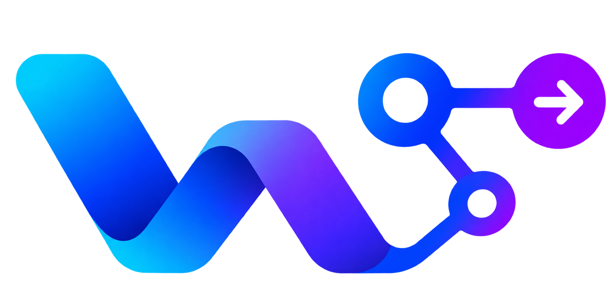
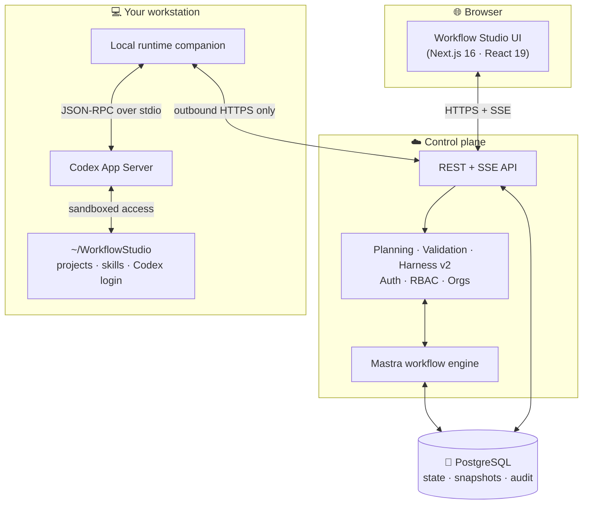

<div align="center">



# Workflow Studio

### Codex does the work. Workflow Studio decides how it runs.

Write down the outcome you want. Workflow Studio turns it into a **visible, reviewable workflow graph** of focused Codex stages, reusable skills, typed handoffs, revision loops, and human approval gates. Then it runs that workflow against your real local projects and keeps a full audit trail.


[Quick start](#-quick-start) · [How it works](#-how-it-works) · [Architecture](#-architecture) · [Commands](#-commands) · [Docs](#-documentation)

</div>

---

## ✨ Why Workflow Studio?

Running Codex directly works well for a one-off task. Teams need more than that when the same process has to run **many times, on many projects, under the same rules**. Workflow Studio wraps Codex in that lifecycle:

| | |
| :--- | :--- |
| 🧭 **Plan from plain language** | Describe a goal in your own words. Codex drafts a full workflow plan: nodes, prompts, skills, input/output contracts, and open questions to answer. |
| 🕸️ **See and edit the graph** | Workflows are typed directed graphs (`codex`, `agent`, `tool`, `validation`, `approval`, `loop`, `fork`, `join`, `success`, `failure`) that you can review and change before anything runs. |
| 🔁 **Bounded revision loops** | `draft → review → revise → validate → approve` cycles with explicit exit conditions and maximum iteration counts. |
| 🛂 **Human gates that can't be skipped** | Four separate lifecycle gates (draft, definition approval, project assignment, in-run approvals), so generated output never bypasses review. |
| 🧩 **Reusable skills** | Pinned skill instructions are matched to nodes, and missing skills are drafted per workflow for you to review. |
| ⚡ **Parallel where it's safe** | Explicit fork/join nodes and a concurrency budget run read-only branches side by side. Steps that write to the project always run alone. |
| 🔐 **Your machine, your login** | In paired mode a local companion runs Codex with *your* ChatGPT Codex login, inside allowed project roots. The server never collects an OpenAI API key or touches your files. |
| 🧾 **Evidence for every run** | Durable events, artifacts, transactional receipts, signed exports, and an immutable audit trail in PostgreSQL. |

It is **domain-neutral**: product planning is one editable example, not a built-in path.

---

## 🚀 Quick start

### Prerequisites

- **Node.js 24.15.x** (pinned in `.nvmrc` / `.node-version`)
- **PostgreSQL**, either local or managed (for example Aiven). Workflow Studio creates its own schema on startup.
- A **ChatGPT account with Codex access**

### 1. Install and configure

```powershell
npm install
Copy-Item .env.example .env.local   # then set your PG* values
npm run db:check                     # confirm the database is reachable
```

### 2. Sign in to Codex and start

```powershell
npm run runtime:login
npm run dev
```

Open **http://localhost:3000** and describe your first workflow. 🎉

> **Tip:** `npm run dev` runs in **direct local mode**: the server starts Codex App Server on the same machine. To try the per-user setup a deployed installation uses, set `CODEX_RUNTIME_MODE=paired` and follow the [companion guide](./docs/local-runtime-companion.md).

### Or with Docker Compose 🐳

PostgreSQL 17 and the app, in paired mode:

```powershell
$env:PGPASSWORD = "choose-a-strong-password"
docker compose up --build
```

---

## 🧠 How it works

Every workflow moves through **four separate gates**. Each one is a deliberate human decision.

```mermaid
flowchart LR
    A["💬 Describe<br/>the outcome"] --> B["🧭 Codex drafts<br/>a workflow plan"]
    B --> G1{{"Gate 1<br/>Save draft"}}
    G1 --> C["🕸️ Review & edit<br/>the graph"]
    C --> G2{{"Gate 2<br/>Approve definition"}}
    G2 --> D["📁 Assign to a<br/>local project"]
    D --> G3{{"Gate 3<br/>Approve assignment"}}
    G3 --> E["⚙️ Durable run<br/>on Mastra"]
    E --> G4{{"Gate 4<br/>In-run approvals"}}
    G4 --> F["🧾 Artifacts, receipts<br/>& audit trail"]
```



1. **Plan.** You describe what you want, with no project needed. A read-only Codex planning thread returns a structured `WorkflowPlan` and drafts any skills that are missing.
2. **Shape.** You answer open questions, then edit nodes, edges, schemas, and skills in the graph editor.
3. **Approve and assign.** You approve a *reusable definition*, then bind it to a specific project root with its own inputs, permissions, and overrides.
4. **Run.** The assignment compiles into an immutable `CompiledWorkflow` plus a `HarnessV2Contract`. Mastra runs it with durable checkpoints, route selection, retries, bounded loops, and approval pauses.

---

## 🏗️ Architecture



| Mode | Set with | What happens |
| :--- | :--- | :--- |
| **Direct local** | `CODEX_RUNTIME_MODE=local` *(dev default)* | The Next.js server starts Codex App Server itself and falls back to the Codex CLI if the provider fails. |
| **Paired companion** | `CODEX_RUNTIME_MODE=paired` *(production default)* | Each user pairs their own computer with a single-use code. The companion takes only that user's jobs, runs Codex locally, keeps file access inside allowed project roots, and sends action approval requests back to the UI. |

**Harness v2** wraps every run in six layers of governance: identity, runtime sandboxing, observability, verification contracts, human-approved adaptation, and security/audit.

Full details are in **[ARCHITECTURE.md](./ARCHITECTURE.md)**.

---

## 🧰 Tech stack

| Layer | Technology |
| :--- | :--- |
| Web app and API | Next.js 16 (App Router), React 19, TypeScript |
| Orchestration | Mastra (`@mastra/core`, `@mastra/pg`) |
| Agent runtime | OpenAI Codex (`@openai/codex`): App Server over stdio, CLI fallback |
| Persistence | PostgreSQL (local, or Aiven with TLS) |
| Contracts | Zod + JSON Schema |
| Local companion | Standalone Next.js app with bundled portable Node |
| Quality | Vitest, PGlite (in-memory Postgres), ESLint |

---

## 📟 Commands

| Command | What it does |
| :--- | :--- |
| `npm run dev` | Start the dev server on `localhost:3000` |
| `npm run runtime:login` | Sign the local Codex runtime in to your ChatGPT account |
| `npm run typecheck` · `lint` · `test` · `build` | The full verification suite |
| `npm run db:check` · `db:verify` | Check connectivity · check schema, indexes, migrations, and audit triggers |
| `npm run db:backup` · `db:restore` | Back up or restore with `pg_dump` (`db:restore -- --file <dump> --confirm`) |
| `npm run companion:build` · `companion:package` | Build the companion · bundle it with portable Node into a release ZIP |
| `npm run launch:check` | Launch preflight checks |
| `npm run load:smoke` · `qualify:runtime` | Load smoke test · runtime reliability qualification |
| `npm run retention:check` · `retention:enforce` | Preview or apply data retention schedules |

Run these before every change:

```powershell
npm run typecheck; npm run lint; npm test; npm run build
```

---

## 📦 Standalone companion

End users get a ZIP with portable Node and npm included, so there's nothing to install system-wide. Extract it, open PowerShell in the folder, and run:

```powershell
& ".\app\tools\node\node.exe" ".\start.cjs"
```

Setup runs automatically, and the BAT launchers are optional. Companion 0.2.0 saves results durably before delivery and replays them after interruptions. More in [companion distribution](./docs/companion-distribution.md) and [runtime reliability and parallel execution](./docs/runtime-reliability-and-parallel.md).

---

## ⚙️ Configuration

All settings are documented in [`.env.example`](./.env.example). The ones you'll touch most:

| Variable | Purpose |
| :--- | :--- |
| `PGHOST` · `PGPORT` · `PGUSER` · `PGPASSWORD` · `PGDATABASE` | PostgreSQL connection (or use `DATABASE_URL` instead) |
| `PGSSL_MODE` · `PGSSL_CA_FILE` | TLS: `disable` locally, `verify-ca` plus a CA file for Aiven |
| `CODEX_RUNTIME_MODE` | `local` (direct) or `paired` (companion) |
| `WORKFLOW_STUDIO_HOME` | Dedicated folder for projects, skills, and Codex login (the global `CODEX_HOME` is ignored) |
| `WORKFLOW_STUDIO_ENFORCE_ROLE_GATES` | Turn on role-based governance in production |
| `WORKFLOW_STUDIO_BOOTSTRAP_ADMIN_EMAILS` | Addresses that get administrator rights on signup |
| `WORKFLOW_STUDIO_COMPANION_CONCURRENCY` | Local worker capacity (maximum 10) |

---

## 🗂️ Project layout

```text
src/
  app/          Next.js pages and API routes (workflows, runs, skills, studio, auth)
  domain/       Planning, graph validation, lifecycle policy, runtime engine, parallel runner
  adapters/     Codex App Server / CLI, Mastra, and paired-runtime adapters
  auth/         Sessions, RBAC, organizations
  server/       Event streams, run coordinator, rate limits, redaction
  storage/      PostgreSQL persistence
companion/      Standalone local runtime companion
scripts/        Database, packaging, qualification, and runtime CLIs
tests/          Vitest suite
docs/           Operations, deployment, and security guides
plan/           Phase-by-phase delivery plan and reports
```

---

## 📚 Documentation

| Guide | Covers |
| :--- | :--- |
| [ARCHITECTURE.md](./ARCHITECTURE.md) | Complete system and architecture reference |
| [Database setup](./docs/database-setup.md) | Local PostgreSQL and Aiven |
| [Local runtime companion](./docs/local-runtime-companion.md) | Paired mode and pairing flow |
| [Companion distribution](./docs/companion-distribution.md) | Building, signing, and shipping the companion ZIP |
| [Runtime reliability and parallel execution](./docs/runtime-reliability-and-parallel.md) | Fork/join, concurrency, recovery, upgrades |
| [Deployment](./docs/deployment.md) | Running the control plane in production |
| [Company launch runbook](./docs/company-launch.md) | Roles, production settings, load tests, launch gates |
| [Operations runbook](./docs/operations-runbook.md) | Day-two operations |
| [Security threat model](./docs/security-threat-model.md) | Trust boundaries and mitigations |
| [requirements.md](./requirements.md) · [plan/](./plan/README.md) | Product requirements and delivery status |

---

<div align="center">

**Workflow Studio** keeps agent work repeatable, reviewable, and auditable.

</div>
