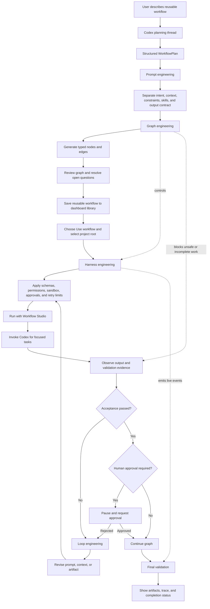

# Requirements Document

# Workflow Studio

Version: 1.6
Updated: 2026-09-04

---

# 1. Overview

Workflow Studio is the visual governance and orchestration layer for Codex-powered work. Codex performs focused agent tasks; Workflow Studio defines the reusable process those tasks must follow, including stages, data contracts, skills, routes, policies, approval gates, completion rules, and retained run evidence.

**Product positioning:** Turn Codex tasks into governed, reusable workflows. Workflow Studio is not a replacement for Codex, another conversational agent, or an agent directory. It is a control plane for teams that need important agent work to be repeatable, reviewable, policy-constrained, and understandable across projects.

Workflow Studio uses Mastra as its durable sequential workflow engine. Codex provides the user's planning and focused execution environment through a project-pinned local runtime. Codex App Server is the primary rich-client integration, with a non-interactive Codex CLI fallback for local planning provider failures. The user shall be able to use local Codex authentication, project access, approvals, and permissions without entering CLI commands during normal use.

The user's initial natural-language request shall normally be sent to Codex App Server as a planning request; a schema-equivalent Codex CLI fallback may be used for local provider failure. Codex shall return a structured workflow plan for review. After the user approves the definition and project assignment, Workflow Studio shall compile, validate, and execute the graph. During execution, only focused node prompts shall be sent to Codex-designated steps; Workflow Studio shall remain the owner of orchestration, state, retries, validation, and observability.

The product turns an ambiguous process into a reviewable, executable, recoverable, and traceable workflow definition. Reliable agent behavior shall come from the complete system around Codex: precise node prompts, explicit state flow, bounded feedback loops, controlled permissions, durable state, validation, approvals, and operational recovery.

## 1.1 Product Boundary and Differentiation

| Experience | Primary job | Appropriate use |
| --- | --- | --- |
| OpenAI Agent Builder (legacy) | Visually assemble typed multi-step agent workflows, preview them, publish versions, and export or deploy them | Building agent behavior for an application through ChatKit or the Agents SDK |
| ChatGPT Workspace Agents | Create repeatable agents through natural language and share them with a team | Giving users access to a shared specialist agent |
| Codex | Interpret a goal and perform adaptive work in a project | One-off or individually directed work where the agent may choose its own path |
| Workflow Studio | Approve an operating procedure, assign it to real projects, enforce project-specific controls, and retain execution evidence | Internal teams governing who may run which Codex process against which project and under which policy |

The core product statement shall remain: **Codex executes the work. Workflow Studio governs which approved process runs against which project, under which controls, and with which evidence.**

Workflow Studio shall not claim that visual nodes, typed data flow, preview/debugging, versioning, or basic guardrails are unique capabilities. The differentiating value shall be the operating lifecycle around Codex work: natural-language process capture, explicit open-question resolution, independent definition approval, reusable-to-project assignment, assignment-specific inputs and permissions, governed skill versions, role-aware human decisions, bounded execution, recovery, and durable evidence grouped by project and process. This product boundary shall remain defensible even if a competing visual builder is introduced, changed, or discontinued.

When a user needs one agent to perform one task, the product shall acknowledge that direct Codex use may be the simpler choice. Workflow Studio shall be positioned for processes that must be followed consistently by a team or repeated across projects.

## 1.2 Implementation Baseline Through Phase 6

| Area | Current status | Implemented baseline |
| --- | --- | --- |
| Phase 1 foundation | Complete | Next.js and TypeScript application, typed workflow model, safe harness defaults, JSON persistence, adapter boundaries, responsive shell, themes, and verified development/production builds |
| Phase 2 planning | Complete | Structured planning form, Codex App Server planning with CLI fallback, streaming lifecycle events, schema validation, ambiguity review, local persistence, graph-review handoff, retry/timeout handling, and execution lock |
| Phase 3 dashboard and workspace foundation | Complete | Unified dashboard, reusable workflow library, structured workflow creation, project assignment at use time, read-only folder inspection, and persistent monitoring dock |
| Phase 3 workflow/skill UI | Complete | Generated skills, ordered version pins, lifecycle controls, compatibility/context metadata, isolated project assignments, and assignment history are implemented |
| Phase 3 graph review | Complete | Visual and readable graph editing, node contracts, assignment graph overrides, full pre-approval validation, and persisted approval readiness are implemented |
| Phase 4 runtime foundation | Complete | Approved assignments compile into durable runs, execute focused Codex tasks, follow explicit branches and bounded loops, enforce project-root permissions, persist events and artifacts, and recover interrupted execution |
| Phase 5 validation and harness | Complete | Independent lifecycle gates, open-question rules, reusable graph approval, assignment validation, editable contracts, stale-write protection, idempotent mutations, resource limits, and edge-case regression coverage |
| Phase 6 live runs and product readiness | Complete | Live and historical runs, focused execution, custom revision/approval routes, paired local Codex action approvals, cancellation/recovery, export, backup/restore, diagnostics, immutable audit, and all six Harness v2 layers are implemented. |
| Phase 7 Mastra runtime integration | Complete | Real `@mastra/core` orchestration, dynamic graph compilation, companion-backed Codex steps, PostgreSQL snapshots, human-gate suspension/resumption, lease fencing, compatibility migration, controlled rollback, and end-to-end qualification. |
| Phase 8 scale, collaboration, and distribution | In progress | Tenant-scoped workspace records, server-managed roles, optional reviewer enforcement, shared rate limits, readiness, aggregate administrator metrics, and load smoke tooling are implemented. Asynchronous pooled PostgreSQL repositories, multi-instance coordination, organizations, parallel graph joins, signed companion distribution, managed integrations, and full production rollout qualification remain. |
| Automated validation | Passing | 195 tests cover foundation, planning and repair, open questions, skill matching, tenant-scoped workspaces, graph validation, Mastra execution, complete runtime loops, verification, exact-choice approvals, paired action approvals, managed roles, lease fencing, persistence recovery, cancellation races, artifact review, approved adaptation reuse, rate limits, health, backup, redaction, and lifecycle safety. |

The supported development path is a local Next.js application started with `npm run dev`. The product uses browser mode and the separate Next.js companion.

# 2. Problem Statement

Codex is effective at interpreting a goal and performing adaptive work, and existing agent builders already provide visual graphs, typed connections, guardrails, previews, and versioned deployment. The remaining problem is operational rather than graphical: internal teams need a durable answer to which approved procedure may run against a specific project, which project-scoped inputs and permissions apply, who must approve a decision, how revision cycles terminate, and what evidence must be retained.

Without that process layer, repeated agent work can vary between users and runs, important controls remain implicit in prompts, and reviewers cannot easily verify that required steps were followed. Workflow Studio addresses this governance and orchestration gap while continuing to use Codex as the planning and execution engine.

Users need an operational product that:

1. Converts a plain-language workflow description into an explicit workflow graph.
2. Lets users select, inspect, and compose reusable skills.
3. Uses the user's Codex environment instead of forcing a separate model or API setup.
4. Shows live execution state, Codex activity, approvals, artifacts, and failures.
5. Prevents incomplete or unsafe workflows from running without review.
6. Converts successful Codex task patterns into versioned processes that can be reused consistently across projects.

# 3. Objectives

- Operationalize prompt engineering by converting user intent and project context into focused, testable instructions.
- Operationalize loop engineering through observe, validate, revise, and bounded-retry cycles.
- Operationalize graph engineering through explicit nodes, edges, branches, joins, loops, and approval gates.
- Operationalize harness engineering through schemas, permissions, tool boundaries, validation, recovery, and observability.
- Enable users to create workflows from natural-language descriptions.
- Enable users to establish an explicit local project boundary and create reusable project-workflow assignments.
- Allow users to review and edit the generated graph before execution.
- Integrate with the user's local Codex environment for focused workflow tasks.
- Execute workflows through the durable Workflow Studio runtime with typed state and bounded retries.
- Show live workflow progress and engineering evidence in the UI.
- Preserve run history, decisions, artifacts, errors, and validation findings.
- Make the boundary between Codex execution and Workflow Studio governance understandable without requiring technical explanation.
- Help teams decide honestly when direct Codex is sufficient and when a governed reusable workflow is justified.
- Treat graph and harness engineering as enabling mechanics for the operating lifecycle, not as standalone product differentiation.

# 3.1 Engineering Model

| Engineering pillar | Product behavior | Evidence available in the product |
| --- | --- | --- |
| Prompt engineering | Each node receives a focused role, context, constraints, and output contract | Prompt preview, context inputs, and structured output |
| Loop engineering | Reviewers and validators cause bounded revision cycles | Draft, review, revise, validate, and retry events |
| Graph engineering | Workflow Studio coordinates specialized nodes and permitted transitions | Visual graph, active path, branches, loops, and gates |
| Harness engineering | The runtime controls permissions, schemas, approvals, retries, and completion rules | Harness panel, blocked actions, validation findings, and run trace |

The system shall make these four pillars visible in the UI and in the final run report. Codex and skills are execution components; Workflow Studio owns graph state and transitions; the harness is the set of controls around the complete workflow.

# 4. Target Users

## Primary Users

- Developers who use Codex and want repeatable engineering workflows.
- AI engineers building multi-agent workflows without writing every graph manually.
- Technical product teams that need reviewable and auditable agent automation.

## Secondary Users

- Product managers who want to describe planning or review workflows.
- Engineering leads who need approval gates and execution history.
- Teams creating reusable skills for recurring internal processes.

# 5. User Inputs

| Input | Description | Required |
| --- | --- | --- |
| Project name | User-facing name for the local project workspace | Required when using or running a workflow; not required for workflow creation |
| Project root | Confirmed absolute local folder that bounds a workflow assignment and execution | Required when using or running a workflow; not required for workflow creation |
| Workflow name | User-facing name for the generated workflow plan | Yes |
| Workflow description | Natural-language request sent to Codex for workflow interpretation and plan generation | Yes |
| Selected reusable workflow | Reusable source definition selected from the dashboard library | Required when creating a project-specific use or run |
| Selected skills | Explicit skill versions attached to workflow nodes or a project assignment | No; safe defaults apply |
| Constraints | Rules, permissions, time limits, or forbidden actions | No |
| Approval policy | Steps requiring human approval and eligible approvers | No |
| Output requirements | Desired files, reports, schemas, or other artifacts | No |
| Execution settings | Retry limits, sandbox mode, and concurrency limits | No; safe defaults apply |

Example workflow description:

```text
Review a product idea, generate requirements, ask me to approve them,
create design guidance, and validate that the design is traceable to the
approved requirements. Use the requirements-review and design-review skills.
```

# 6. Functional Requirements

## 6.1 Project Workspaces, Navigation, and Workflow Boundaries

### Responsibilities

The system shall allow users to create and edit reusable workflow definitions without selecting a project root.

The system shall request a project root only when the user chooses to use, assign, test against, or run a reusable workflow. Project selection shall not gate workflow creation, Codex plan generation, skill editing, or graph editing.

The system shall support empty folders, existing repositories, and existing non-development workspaces without assuming that every project is software source code.

The system shall inspect existing project folders in read-only mode and shall show the exact confirmed root and detected workspace type before project-specific assignment or execution.

Browser mode shall provide a controlled server-side directory browser and empty-folder creation flow.

The system shall provide an autofill action that selects and inspects the local application root as an editable development example without silently confirming access.

The system shall represent reusable workflow definitions separately from project-specific assignments. Assignment-level inputs, permissions, harness overrides, selected skill versions, and run references shall not mutate the reusable source definition.

The application shall use a dashboard without a persistent left navigation sidebar. The dashboard shall place workflow creation and the workflow library on `/`; each workflow graph shall open on `/workflows/{workflowId}/graph`; the skill registry shall open on `/skills`; skill creation shall open on `/skills/new`; and skill editing shall open on `/skills/{skillId}/edit`. Monitoring logs remain in the dashboard bottom dock.

The dashboard shall provide a prominent `Create workflow` action. Created workflows shall appear as first-class library cards rather than as sidebar history.

The public landing page shall lead with the Workflow Studio product promise: agent workflows that users can see, shape, and trust. The hero and primary call to action shall use product-led language rather than repeatedly naming the underlying planning or execution runtime.

The landing page shall distinguish Workflow Studio from generic trigger-and-action automation by emphasizing judgment, evidence, project context, validation, approvals, and controlled execution. Detailed runtime and competitor positioning shall remain available for product demonstrations and technical documentation without dominating the public brand message.

The landing page shall not imply that Workflow Studio replaces Codex, provides a proprietary foundation model, or uniquely invented graphs, typed data flow, harness controls, preview, or workflow versioning.

### Output

The system shall produce a confirmed project record with a stable identifier, schema version, root path, workspace type, status, and timestamps.

The system shall preserve project, reusable workflow, assignment, plan, and root-path identifiers through later planning, review, execution, and history requests.

## 6.2 Prompt and Context Engineering

### Responsibilities

The system shall accept a natural-language workflow description and create a draft workflow definition.

The system shall send the original planning prompt to a Codex App Server planning thread and request a structured `WorkflowPlan`, rather than treating free-form planning prose as an executable workflow definition.

The `WorkflowPlan` shall describe nodes, dependencies, skills, node prompts, inputs, outputs, approval gates, retry and loop limits, and completion criteria. The model shall remain domain-neutral so a user can compose any workflow supported by the available node, skill, tool, permission, and output contracts; product planning is one editable example rather than a hard-coded workflow type.

The system shall separate the user request into task intent, project context, constraints, tool permissions, and completion criteria.

The system shall generate focused prompts for each workflow node rather than passing the full user request to every node.

The system shall show the prompt, context, constraints, and expected output schema assigned to each node.

The UI shall display the generated plan and prompt/context previews before execution. The runtime shall compile only the user-approved plan and assignment. Execution-time Codex prompts shall contain the focused node prompt, relevant prior outputs, selected skills, and current harness state; the full original planning prompt shall not be sent to every node unless explicitly required.

The system shall identify or propose:

- Workflow stages.
- Agent or Codex responsibilities.
- Required skills.
- Inputs and outputs.
- Tools and external resources.
- State passed between stages.
- Branching and looping conditions.
- Human approval points.
- Completion and validation criteria.

### Output

The system shall produce a draft workflow graph and a plain-language summary of the interpreted workflow.

The system shall produce a structured `WorkflowPlan` draft and a prompt/context preview for each execution node.

The system shall identify unresolved ambiguities as open questions rather than silently inventing requirements.

The system shall require either a non-empty answer for every Codex open question or an explicit acknowledgement that the user is continuing with unresolved questions before a generated workflow can be added to the reusable library. The UI shall require confirmation for the unresolved path, and the workflow-save API shall reject unresolved questions unless the acknowledgement flag is supplied.

After all current questions are answered, the user shall be able to either submit the answers for another Codex planning pass or keep the current generated graph. A new planning pass shall receive the previous plan and complete answer history, revise nodes and skill assignments, remove resolved questions, and return any genuinely new questions. This loop may repeat. Keeping the current graph shall preserve the answers and explicitly close the current questions without changing the generated graph. Continuing without answers shall preserve unanswered items in `openQuestions` and shall not represent them as resolved.

## 6.3 Reusable Skills

### Responsibilities

The system shall allow users to browse available skills.

When a generated workflow is saved, the system shall materialize every new Codex-proposed skill reference as a persisted workflow-scoped draft. If an executable Codex, agent, tool, or validation node has no skill reference, the system shall derive a stable workflow-owned draft skill from that node's prompt, inputs, outputs, and completion criteria.

The system shall reuse an existing skill with the same identifier instead of silently creating a duplicate. Automatically generated skills shall remain drafts until explicitly reviewed or published by the user.

Each planning request shall include a server-derived catalog of installed Codex skills and published workspace skills. The planner shall attach exact catalog identifiers to nodes that require those capabilities. Workflow Studio shall independently reinforce strong capability matches—for example, attaching `imagegen` and the UI-screen generator to a node that generates UI screen images—and shall register referenced installed skills as published capabilities instead of generating substitute drafts.

Each skill shall expose:

- Name and description.
- Trigger conditions.
- Required context.
- Inputs and outputs.
- Tools or permissions required.
- Rules and boundaries.
- Validation criteria.

The system shall allow users to add, remove, and reorder skills before workflow execution.

The system shall prevent a workflow from using a skill whose required inputs or permissions are unavailable unless the user explicitly resolves the issue.

### Output

The system shall show the selected skills and their position in the workflow graph.

### Skill lifecycle and maintenance

The system shall allow authorized users to create, inspect, edit, delete, duplicate, archive, and restore local skills without manually editing files. Deleting a skill shall require confirmation and remove that skill reference from all persisted workflow nodes so no dangling reference remains.

Each skill shall have a version, updated timestamp, author or source, status, and compatibility metadata.

The system shall warn users when a skill is stale, deprecated, incompatible with the current runtime, or missing required dependencies.

The system shall support refreshing skill metadata and instructions from an approved source without silently changing an active workflow.

The system shall preserve the skill version used by each workflow and run so that historical runs remain reproducible.

The system shall show an estimated token or context size for each skill before it is selected.

The system shall identify duplicate, redundant, or oversized skill instructions and recommend pruning or splitting them.

The system shall allow users to activate, deactivate, archive, and scope skills by workspace or workflow.

The system shall keep skill instructions, examples, rules, and references separate where possible so that only relevant content is loaded into an execution prompt.

The system shall require explicit confirmation before updating a skill version used by an existing workflow.

The system shall record skill changes in an audit history containing the previous version, changed fields, editor, and timestamp.

## 6.4 Graph Engineering and Review

### Responsibilities

The system shall display workflow nodes and edges visually.

The graph shall distinguish at minimum:

- Agent steps.
- Codex steps.
- Tool steps.
- Parallel branches.
- Conditional branches.
- Loops and retry paths.
- Automated validation gates.
- Human approval gates.
- Terminal success and failure states.

The system shall allow users to inspect and edit node instructions, selected skills, inputs, outputs, limits, and approval settings. Skill-backed nodes shall be presented as focused specialist stages with visible skill versions and artifact ownership; this must not be described as a native Codex subagent unless the runtime actually delegates through a native subagent mechanism.

Approval nodes shall support user-defined button labels and route keywords instead of requiring yes/no. Each outcome shall explicitly continue, revise through a bounded loop, or stop. Continue and revise keywords shall match an outgoing graph condition exactly, and the runtime shall persist the selected option, keyword, behavior, actor, feedback, and resulting route.

The system shall validate the graph before allowing execution.

Validation shall detect missing inputs, incompatible outputs, unreachable nodes, unbounded loops, missing failure paths, and approval gates without a continuation path.

## 6.5 Codex Integration

### Responsibilities

The integration shall expose two distinct modes:

1. **Planning-time Codex task:** the user's natural-language planning prompt is sent to Codex, which returns a structured `WorkflowPlan` for UI review.
2. **Execution-time Codex task:** Workflow Studio sends a focused prompt for an approved Codex-designated node and receives a structured node result.

The system shall allow a workflow to designate a step as a Codex task.

The Codex task shall support a focused prompt, selected skills, workspace context, expected output schema, sandbox mode, and approval policy.

The system shall prefer Codex App Server for local planning so the product can use the supported thread, turn, item, approval, and streaming protocol. The integration shall initialize the protocol once per connection and apply read-only planning access. Reusable workflow creation shall use an internal planning workspace; a confirmed project root shall become `cwd` only for project-specific planning or execution.

Direct local development may fall back to non-interactive Codex CLI planning only when App Server returns a provider failure. A deployed installation shall dispatch through the authenticated user-owned companion and shall not fall back to a Codex process or account owned by the web host.

The application distribution shall include a compatible project-pinned `@openai/codex` runtime so the companion does not depend on a separately installed global CLI. Each local companion shall use that computer's Codex authentication state.

The deployed application shall pair a local runtime to exactly one authenticated Workflow Studio user. Workflow jobs, events, results, project roots, and connection credentials shall remain ownership-scoped and shall not be dispatchable through another user's runtime.

The deployed application shall not require or collect an OpenAI API key. A paired companion shall verify a user-managed ChatGPT Codex login and report only non-secret connection status and an optional account label. Codex access and refresh credentials shall remain on the user's computer.

The companion shall initiate outbound authenticated HTTPS communication with the deployed control plane. Codex App Server shall remain local and communicate with the companion over `stdio`; it shall not be exposed directly to the public internet.

Pairing codes shall be high entropy, expire within ten minutes, and be single use. Runtime bearer credentials shall be stored only as hashes by the server, be revocable, and authorize only the paired connection's jobs.

The companion shall canonicalize requested project paths and reject any planning or execution task outside the folders explicitly allowed during pairing.

The system shall not require the user to type CLI commands during normal workflow creation or execution. The browser-first release uses one copyable command for companion startup. Phase 8 shall add signed managed distribution without changing the runtime protocol or requiring a native installer.

The system shall show user-meaningful Codex task status, streamed messages, tool activity, file changes, approvals, and final structured output when available. Internal remote-control, MCP startup, shell-snapshot, and stdin transport noise shall not be shown as user-facing planning events. Workflow-stage approvals and local Codex action approvals shall be separate: the former chooses the next graph route, while the latter authorizes one command, file change, network request, permission grant, or tool side effect inside the active task.

The system shall prevent a Codex task from accessing a workspace or tool not allowed by the workflow configuration.

### Output

The system shall return Codex results to the durable workflow state as typed step output.

The system shall preserve the Codex thread or run identifier for traceability and continuation.

The system shall preserve the planning thread identifier, workflow plan identifier, execution run identifier, and node task identifier for traceability. A Codex planning response shall not bypass user approval, compilation, or workflow validation.

## 6.6 Loop Engineering and Workflow Execution

### Responsibilities

The system shall execute approved workflows through Workflow Studio's durable runtime.

The current runtime shall support deterministic sequential steps, conditional branches, bounded loops, retries, approvals, and shared typed state. Phase 7 shall migrate these semantics to real Mastra orchestration. Independent runs may execute concurrently. Phase 8 shall add explicit parallel branches and deterministic join semantics inside one run.

Phase 7 shall install and invoke `@mastra/core` in production execution. It shall dynamically compile validated user-authored workflow definitions, execute companion-backed Codex steps, persist suspend/resume snapshots in PostgreSQL, correlate Mastra identifiers with Workflow Studio records, and fail closed when a graph feature cannot be represented safely. A class or interface named Mastra without an active Mastra runtime shall not satisfy this requirement.

The system shall represent every revision cycle as an explicit loop with an observable entry condition, exit condition, iteration count, and maximum iteration limit.

The system shall support the pattern `draft -> review -> revise -> validate -> approve` for reusable workflows across supported project domains.

The system shall distinguish a validation failure, a human rejection, a tool failure, and a missing-context condition.

The system shall emit lifecycle events for workflow creation, node start, node progress, node completion, node failure, approval required, workflow pause, workflow resume, and workflow completion.

The system shall allow users to pause a running workflow when the workflow reaches a configured human approval gate.

The system shall allow users to resume a paused workflow with an approval decision and optional feedback.

The system shall stop execution when a required approval is rejected, a validation gate fails after the retry limit, or a safety boundary is violated.

## 6.7 Live Execution View

### Responsibilities

The system shall display the current workflow graph during execution.

The view shall show:

- Current active node.
- Completed and pending nodes.
- Failed nodes and retry count.
- Branch selected.
- Loop iteration count.
- Human approval state.
- Codex activity and streamed output.
- Generated artifacts.
- Validation findings.
- Elapsed time and basic usage metrics when available.

The system shall allow a user to select a node and inspect its inputs, outputs, status history, errors, and decisions.

The system shall reconnect to an active run and recover the latest known state after a temporary UI or network interruption.

## 6.8 Harness Engineering

### Responsibilities

The harness shall define the operating rules around every workflow, including context loading, tool permissions, sandbox mode, schemas, retries, approvals, validation, persistence, and escalation behavior.

The harness shall be implemented as six versioned layers with distinct contracts and responsibilities:

1. **Identity and behavior:** durable workflow and agent identity, approved instructions, loadable skill versions, compiled context, context budgets, behavioral boundaries, and adaptation limits.
2. **Runtime:** execution engine, tools, workspace scope, context loading, persisted state, checkpoints, transitions, retries, loops, timeouts, cancellation, recovery, and escalation.
3. **Observability:** correlated traces, latency, usage and cost signals when available, retries, failures, artifacts, decisions, redaction, retention, inspection, and export.
4. **Verification:** schemas, completion contracts, evidence and citation requirements, required artifacts, acceptance thresholds, remediation routes, and human decision gates.
5. **Adaptation:** opt-in reuse of evaluated run outcomes, feedback and improvement candidates, provenance, promotion authority, immutable versions, privacy scopes, and rollback.
6. **Governance and security:** cross-cutting authentication, authorization, least privilege, isolation, policies, approvals, data classification, secret handling, audit, retention, export, and adaptation authority.

Every compiled run shall preserve the exact version of all six layer contracts that governed it. Governance and security shall constrain every other layer rather than being represented only as a workflow node.

The system shall keep automated acceptance checks separate from human approval decisions.

The system shall allow approval requirements to be configured per workflow node.

The system shall display the evidence and requested changes associated with an approval request.

The system shall record the approver, decision, reason, timestamp, and feedback.

The system shall apply safe default sandbox and retry settings when the user does not provide settings.

The system shall require explicit confirmation before enabling broader workspace access or destructive actions.

The system shall expose harness decisions and blocked actions in the live run view.

The system shall refuse completion when the final completion contract has not been satisfied, even if the last agent returned a successful message.

## 6.9 Artifacts and Run History

### Responsibilities

The system shall store workflow definitions, skill selections, run inputs, node events, approval decisions, validation results, and generated artifacts.

The system shall allow users to inspect previous runs and compare artifacts between runs.

The system shall label artifacts with their source, version, producing node, and validation status.

The system shall allow users to export a workflow definition and its run summary.

The system shall allow users to delete locally saved workflow plans from History through an explicit two-step destructive confirmation. Deleting one plan shall not remove unrelated projects or workflow records.

## 6.10 Workflow Validation

### Responsibilities

The system shall validate workflow definitions before execution.

The system shall validate run outputs against declared schemas and completion criteria.

The system shall verify that required artifacts exist before marking a workflow complete.

The system shall report traceability gaps, contradictory outputs, missing approvals, malformed results, and exceeded retry limits.

The system shall not report success when required validation checks have failed.

# 7. Non-Functional Requirements

## Performance

- The system shall display workflow creation feedback within 5 seconds for normal descriptions, excluding model wait time.
- The live execution view shall display received runtime events within 2 seconds under normal local-network conditions.
- The UI shall remain responsive while a workflow is running.

## Reliability

- The system shall persist workflow state at approval and pause boundaries.
- A disconnected UI shall be able to reconnect to an active run without restarting it.
- Every workflow shall have a configurable maximum retry or revision count.
- A failed Codex or workflow-runtime step shall produce a visible error state and recovery action.
- App Server provider failures shall use the CLI fallback by default; malformed or invalid plans shall not be treated as provider failures.
- Planning form values shall remain available after timeout, provider failure, or malformed output.

## Accuracy and Correctness

- Generated workflows shall use explicit typed inputs and outputs for every executable node.
- The system shall preserve user-provided constraints when compiling a workflow.
- The system shall surface ambiguity instead of fabricating missing context.
- The system shall prevent downstream steps from consuming artifacts that failed required acceptance checks.
- Public product copy and demos shall not present OpenAI-provided primitives such as prompts, context, loops, graphs, typed data flow, approvals, or guardrails as proprietary Workflow Studio inventions.
- Competitive positioning shall distinguish the integrated project-assignment lifecycle from individual features and shall be revalidated against current vendor capabilities before external demos.

## Usability

- A first-time user shall be able to create and review a basic workflow without writing code.
- The UI shall provide both a visual graph and a readable step-by-step representation.
- Every status, error, approval request, and validation result shall use plain-language labels.
- Project selection and workflow description shall be separate screens with clear prerequisite locking.
- Project and workflow forms shall provide optional autofill actions for onboarding, local evaluation, and repeatable testing.
- Internal implementation labels and raw provider protocol events shall not be used as primary UI status text.

## Accessibility

- Core workflow creation, graph inspection, approval, and run-history actions shall be keyboard accessible.
- Status shall not be communicated by color alone.
- The UI shall support readable contrast, focus states, and screen-reader labels for graph controls.

## Security and Privacy

- Secrets and user authentication details shall not be exposed to the browser beyond what is required for the active session.
- The system shall isolate each user's workspace, workflow definitions, run history, and artifacts.
- The system shall apply least-privilege workspace and tool permissions.
- The system shall require authenticated and authorized access to workflow runs and artifacts.
- Remote connections shall use authenticated and encrypted transport.
- Browser-mode project paths shall refer to the filesystem of the local Next.js server process; the application shall not imply access to a remote browser user's filesystem.
- Project inspection shall read directory names and metadata only and shall not read file contents until an explicitly authorized planning or execution operation requires them.

## Maintainability

- Workflow definitions shall be serializable and versioned.
- Skills shall be independently updateable without rewriting every workflow.
- Skill versions and their source metadata shall be visible and traceable.
- Skill updates shall not silently alter existing workflow behavior.
- Skill content shall be bounded, inspectable, and selectively loaded to limit unnecessary context usage.
- Runtime adapters shall be replaceable without changing the workflow definition format.
- The supported Node.js runtime shall be pinned to an active stable release; the current baseline is Node.js `24.15.0`.

## Compatibility

- The local Next.js browser experience shall provide the complete product UI.
- Browser and companion capabilities shall fail closed when their authenticated runtime connection is unavailable.
- Windows paths and POSIX paths shall be normalized and validated by the server runtime appropriate to the host operating system.

## Scalability

- The runtime shall support multiple independent workflow runs.
- The system shall support concurrency limits per user, workspace, and workflow.
- Long-running or paused workflows shall not require the browser to remain open.

# 8. System Modules

1. Workflow Studio UI.
2. Project Workspace Manager.
3. Reusable Workflow Library and Assignment Manager.
4. Prompt and Context Builder.
5. Skill Registry and Skill Composer.
6. Workflow Graph Editor.
7. Loop and Revision Controller.
8. Workflow Compiler and Validator.
9. Workflow Studio Runtime.
10. Codex App Server and CLI Adapter.
11. Harness Policy and Permission Manager.
12. Live Event and Run Monitor.
13. Artifact and Run History Store.

# 9. Product Release Scope

## The product release shall include

- Natural-language workflow creation.
- Dashboard-first reusable workflow creation without a project prerequisite.
- Read-only inspection and explicit confirmation for empty or existing local project folders.
- Browser-based folder navigation and companion folder selection.
- Reusable workflow definitions and project-specific assignments.
- Prompt and context preview for each node.
- A curated local skill registry.
- Automatic creation of workflow-scoped draft skills from generated workflow nodes and Codex skill references.
- Registry controls to inspect, edit, and confirm deletion of generated or manually created skills.
- User-editable and versioned skills with stale-content warnings.
- Skill size visibility and basic duplicate/overlap warnings.
- Skill activation, deactivation, archiving, and workspace scoping.
- Draggable generated workflow graph with editable nodes and connections.
- Manual graph and skill review before execution.
- Sequential workflow execution.
- One Codex task node using the user's local Codex environment.
- One automated validation gate.
- One human approval gate.
- One visible draft-review-revise-validate loop with a bounded retry limit.
- Harness panel showing schemas, permissions, and completion rules.
- Live run status and node events.
- Run history with generated artifacts and validation findings.
- Deletion of locally saved workflow plans with explicit confirmation.
- Local-first workspace support.
- Codex App Server planning with a compatible CLI fallback.

## The current product release shall NOT include

- A replacement for the Codex client or Codex execution engine.
- A generic conversational assistant or directory of standalone agents.
- A general-purpose competitor to OpenAI Agent Builder, Workspace Agents, or the Agents SDK.
- Claims that direct Codex use requires Workflow Studio for simple or one-off tasks.
- Multi-tenant hosted execution.
- Arbitrary third-party integrations.
- Unrestricted remote workspace access.
- Automatic destructive actions.
- Marketplace publishing for skills.
- Complex collaborative editing.
- Fully autonomous workflow generation without user review.
- Billing, quotas, or enterprise administration.

# 10. Success Criteria

The product release shall be considered ready when:

1. A user can create and save a reusable workflow without selecting a project root.
2. From `Use workflow`, a user can select or create a local project folder, inspect it read-only, and explicitly confirm its exact root.
3. A user can describe a workflow and receive a valid editable graph draft.
4. The UI makes it clear that the initial planning prompt is sent to Codex and converted into a structured `WorkflowPlan`.
5. The UI shows how the approved plan becomes focused node prompts.
6. A user can assign reusable workflows across projects without project-specific changes mutating the source definition.
7. Saving a generated workflow creates any missing workflow-owned skills as drafts, and a user can see them attached to workflow nodes.
8. A user can edit, version, activate, deactivate, and archive a skill.
9. A workflow records the exact skill versions used during a run.
10. The UI shows skill freshness and estimated context size before execution.
11. A user can inspect and approve the generated graph before execution.
12. A workflow can run deterministic workflow-control stages and at least one focused Codex stage.
13. The UI shows live node progress, graph path, loop iterations, and final run status.
14. A failed validation gate produces a visible revision loop with a bounded retry limit.
15. A human approval gate pauses execution and resumes only after a decision.
16. The harness blocks an action when required context, permissions, schema, or approval is missing.
17. The final run includes traceable prompts, context, artifacts, decisions, and validation findings.
18. Codex planning cannot bypass user approval, compilation, or final validation.
19. A disconnected and reconnected UI can recover the active run state.
20. No required user workflow action requires opening a terminal.
21. A first-time visitor can explain within one sentence that Workflow Studio makes agent workflows visible, controllable, reusable, and traceable across real projects.
22. The landing page clearly distinguishes controlled agent workflows from generic trigger-and-action automation without depending on a vendor name to communicate the product's value.

# 11. Future Enhancements

- Visual drag-and-drop workflow authoring.
- Natural-language editing of an existing graph.
- Multiple Codex tasks running in parallel.
- Remote Codex environments and cloud workspaces.
- Skill sharing and marketplace publishing beyond the local Phase 3 registry.
- Team roles and approval policies.
- GitHub, GitLab, Linear, Slack, and issue-tracker integrations.
- Workflow templates and scheduled runs.
- Evaluation dashboards and regression testing.
- Cost and token budgets per workflow.
- Multi-user collaborative workflow editing.
- Phase 7 real Mastra workflow orchestration with PostgreSQL-backed snapshots and a versioned compatibility migration from the custom runtime.
- Phase 8 PostgreSQL-backed control-plane persistence with pooled asynchronous repositories and transactional coordination.

# 12. Assumptions and Open Questions

## Assumptions

- The product is local-first and initially optimized for technical users.
- The application includes a project-pinned Codex runtime; users authenticate that local runtime before planning.
- Mastra becomes the workflow execution engine in Phase 7; Workflow Studio remains the governance, ownership, policy, review, artifact, audit, and durable correlation layer.
- Codex is used as a focused execution specialist inside the workflow.
- The Next.js control plane connects the browser UI with the Workflow Studio runtime and the user's local Codex companion.

## Resolved Decisions Through Phase 6

1. The supported development UI is the local Next.js browser application.
2. The product supports multiple persisted local project records and saved workflow plans.
3. Planning and focused execution are supported Codex task modes; Workflow Studio remains responsible for the approved graph, harness policy, state transitions, and run evidence.
4. The implementation stores control-plane records and Mastra workflow state in PostgreSQL. The database architecture does not change the per-user local Codex companion boundary.
5. The default Monitor view shows meaningful lifecycle events and filters internal provider protocol noise.
6. Reusable workflow creation is project-independent; project roots are selected from `Use workflow` for assignment or execution.
7. The primary application shell is a unified dashboard without a left sidebar.
8. Workflow Studio is positioned as a complementary governance and orchestration layer for Codex, not as a replacement agent experience.
9. Direct Codex is the recommended path for simple one-off tasks; Workflow Studio is for reusable processes with mandatory controls and organizational accountability.
10. Graph editing, typed contracts, previews, harness controls, and versioning are supporting capabilities rather than unique product claims; project-assigned operating governance is the primary product boundary.

## Phase 8 Product Decisions (not Phase 6 or Phase 7 release blockers)

1. Which approval actions require a second user or role-based authorization?
2. Should advanced provider diagnostics be available behind an optional developer view?

# 13. Prompt Routing and End-to-End Engineering Flow

The prompt shall move through the system in two stages:

```text
User planning prompt
        |
        v
Codex planning thread
        |
        v
Structured WorkflowPlan
        |
        v
UI graph, prompt, and harness review
        |
        v
Reusable workflow library
        |
        v
Use workflow + confirmed project root
        |
        v
Project-specific assignment
        |
        v
User approval
        |
        v
Workflow Studio graph compilation and durable execution
        |
        v
Focused Codex node prompts + deterministic runtime checks
```

The initial prompt is a planning input to Codex, not an instruction for Codex to own or directly execute the entire workflow. Workflow Studio shall use the approved plan and project assignment as the runtime source of truth.

The product shall make the following flow visible and traceable:



## Engineering Pillar Mapping

| Flow stage | Engineering focus | What the user can see |
| --- | --- | --- |
| Describe and prepare | Prompt engineering | The original request, selected context, constraints, skills, and output contract |
| Generate and review | Graph engineering | Nodes, edges, branches, loops, gates, and unresolved questions |
| Configure and control | Harness engineering | Schemas, permissions, sandbox mode, approval rules, retry limits, and completion rules |
| Execute and observe | Workflow Studio plus Codex runtime | Active node, Codex task, tool activity, streamed output, and events |
| Review and improve | Loop engineering | Validation findings, revision path, iteration count, and changed artifact |
| Complete and hand off | Harness plus validation | Final approval, traceability report, artifacts, and remaining risks |

# 14. Expected User Flow

1. The user opens the Workflow Studio dashboard and sees created workflows, the creation area, skill registry, and monitoring dock.
2. The user selects `Create workflow` and enters or autofills a natural-language workflow description, constraints, outputs, and safe harness defaults without selecting a project.
3. The system sends the request to a Codex App Server planning thread and uses the CLI fallback only for provider failure.
4. Codex returns a structured workflow plan containing proposed nodes, edges, prompts, skills, harness rules, and completion criteria.
5. The UI shows the plan summary, warnings, open questions, readable stages, connections, and harness settings.
6. The user saves the reusable definition; the system materializes its proposed and derived skills as workflow-scoped drafts and displays them in the dashboard registry.
7. The user opens `/skills` to inspect or delete generated skills, uses dedicated create/edit skill routes, and opens `/workflows/{workflowId}/graph` to drag nodes, edit prompts and settings, add or remove connections, and assign skills.
8. When ready to apply the workflow, the user selects `Use workflow`, chooses or creates a project root, and creates a project-specific assignment without mutating the source definition.
9. Workflow Studio compiles and validates the approved graph and assignment into an immutable run.
10. Workflow Studio runs the graph and sends only focused prompts to Codex-designated nodes.
11. The UI displays live node progress, Codex activity, tool calls, and generated artifacts.
12. The workflow pauses at a human approval gate when required.
13. The user reviews the evidence and approves, rejects, or requests changes.
14. Workflow Studio resumes, revises, or stops according to the decision.
15. The system runs final validation and marks the workflow complete or failed.
16. The user reviews the final artifacts, trace, decisions, and validation report, and may delete obsolete saved workflow plans.
